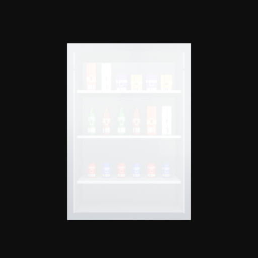
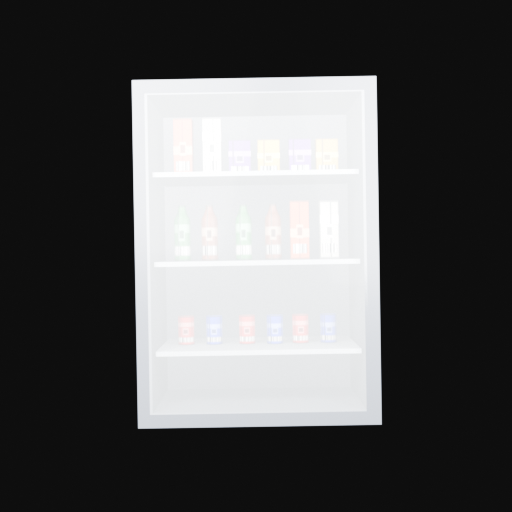

# BVT Retail Demo v0.1 — Showcase

These images are canonical sample outputs generated from the frozen
Beverage Fridge scene.

They are committed to the repository so the public release can be
evaluated without running Blender first.

## Clean

Deterministic reference without Artifact Engine or scene
randomization.



YOLO annotation:

```text
showcase/labels/clean.txt
```

## Balanced

Typical training-oriented variation with mild placement, camera,
lighting and probabilistic Artifact Engine effects.



YOLO annotation:

```text
showcase/labels/balanced.txt
```

## Artifacts

Artifact Engine v1 demonstration with all eleven providers enabled.


YOLO annotation:

```text
showcase/labels/artifacts.txt
```

## Stress

Maximum public v0.1 scenario combining Artifact Engine v1 with:

```text
Wrong Angle
Wrong Position
Empty Slot
Occlusion
```


YOLO annotation:

```text
showcase/labels/stress.txt
```

## Reproducibility

All four images use canonical release presets and the frozen Beverage
Fridge scene.

The source frame for the v0.1 showcase is:

```text
000001
```

Hashes and object counts are stored in:

```text
showcase/showcase-v0.1.json
```

These images are presentation assets.

Dataset integrity remains governed by the Dataset v0.1 manifest,
validation and hashes contracts.
